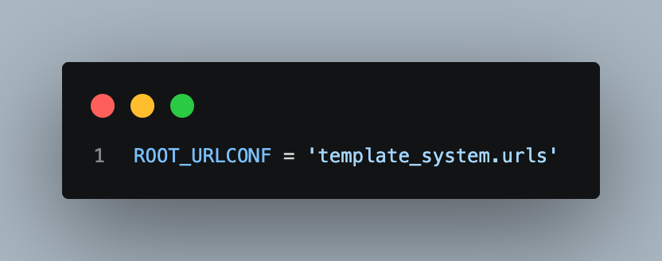

## 1. 학습 목표 요약


1. `Template System`을 사용하면 같은 HTML 구조를 유지하고 내용만 변경할 수 있습니다.
2. `Template 상속` 을 활용하면 여러 템플릿에 걸쳐 필요한 공통 요소를 한곳에 작성할 수 있습니다.
3. Django의 `URL Dispatcher` 는 많은 URL들을 관리하기 위한 다양한 기능을 갖추고 있습니다.

<br>
<hr>
<br>

## 2. Django Template System

**Django Template System**은 **데이터를 활용하여 동적인 HTML 문서를 생성하는 시스템**

Django의 **View에서 전달한 데이터를 HTML에 표시**하거나, **조건문과 반복문을 사용**하여 **상황에 따라 다른 HTML을 생성**할 수 있도록 도와줌

일반적인 HTML은 작성된 내용이 고정되어 있지만, Django Template System을 사용하면 동일한 HTML 구조를 유지하면서 데이터에 따라 내용을 동적으로 변경할 수 있음

### 일반 HTML 과 Django Template 비교

**일반 HTML**

```html
<h1>안녕하세요, 홍길동님!</h1>
```
- HTML에 작성된 내용이 그대로 출력
- 사용자 이름이 변경되면 HTML 코드도 수정해야 함

<br>

**Django Template**

```html
<h1>안녕하세요, {{ username }}님!</h1>
```
- `{{ username }}` 부분에 **View에서 전달받은 데이터가 삽입됨**
- HTML 코드를 수정하지 않아도 사용자에 따라 다른 이름을 출력할 수 있다.

### Django Template System 동작 원리


중요한 점은 **View에서 전달받은 데이터**가 브라우저에서 처리되는 것이 아니라 **Django 서버에서 실제 데이터로 변환**된 후 HTML이 클라이언트에 전달되는 것

**'페이지 틀'에 '데이터'를 동적으로 결합**하여 수많은 페이지를 효율적으로 만들어 내기 위함

<br>
<hr>
<br>

## 3. Django Template Language (DTL)

Django Template System에서는 HTML 내부에서 동적인 기능을 작성하기 위해 DTL(Django Template Language)이라는 **템플릿 언어** 사용

### DTL 주요 구성 요소

|구성 요소|문법|역할|
|---|---|---|
|Variable|`{{ variable }}`|데이터 출력|
|Tag|``|조건문, 반복문 등의 기능 수행|
|Filter|`{{ variable\|filter }}`|데이터 출력 형태 변경|
|Comment|`{# comment #}`|템플릿 주석 작성|

#### 1. Variable -- 주석

View에서 전달받은 데이터를 HTML에 출력할 때 사용

**View에서 전달한 `context` 의 키를 이용**하여 데이터에 접근
```html
<h1>{{ username }}</h1>
<p>{{ age }}</p>

<!--객체의 속성에도 접근 가능-->
<p>{{ article.title }}</p>
<p>{{ article.content }}</p>
```

<br>

#### 2. Tag -- 태그

HTML 내부에서 조건문이나 반복문 등의 기능 수행

```html
<!-- 조건문 -->

    <p>성인입니다.</p>

    <p>미성년자입니다.</p>


<!-- 반복문 -->

    <h2>{{ article.title }}</h2>
    <p>{{ article.content }}</p>

```

Python의 문법과 비슷하지만 그대로 사용하는 것이 아니라 **별도의 정의된 템플릿 문법 사용**

<br>

#### 3. Filter -- 필터

변수에 적용하여 데이터의 형태를 변경

```html
{{ username|upper }} <!-- username이 'django' 일 때 > 'DJANGO' 로 출력됨-->

{{ username|length }} <!-- 문자열의 길이 출력 -->

<!-- 여러 Filter을 연결해서도 사용 가능 -->
{{ username|lower|capfirst }}
```

<br>

#### 4. Comment -- 주석

템플릿 내부에 주석을 작성할 때 사용

```html
{# 한 줄 주석입니다. #}


    이 부분은 
    HTML 결과에 출력되지 않습니다
s
```

**DTL 주석**은 **서버에서 템플릿을 처리하는 과정에서 제거**되므로 클라이언트에 전달되는 **HTML에 포함되지 않음** &nbsp; | [개발자 도구로 확인한 HTML](./images/03_DTL의%20주석.png)

<br>
<hr>
<br>

## 4. Template 상속 (Template Inheritance)

Template 상속이란 여러 HTML 템플릿에서 **공통**으로 사용하는 **구조와 요소를 하나의 부모 템플릿에 정의**하고, **자식 템플릿에서 이를 재사용**하는 기능

Django Template System 에서 제공하는 기능으로, HTML 코드의 중복 작성을 줄이고 웹 페이지의 일관된 구조를 유지할 수 있음

### Template 상속 장점

<br>

- 코드 재사용성 향상 : 공통 HTML 구조를 반복해서 작성하지 않아도 됨
- 유지보수 용이 : 부모 템플릿만 수정하면 이를 상속받은 페이지에도 반영
- 일관성 유지 : 여러 페이지에서 동일한 레이아웃과 디자인 유지
- 개발 생산성 향상 : 각 페이지에 필요한 고유 콘텐츠 작성에 집중할 수 있음

<br>

### Template 상속 구조


|구분|설명|
|---|---|
|부모 템플릿(Parent Template)|공통 HTML 구조와 자식이 재정의할 영역을 정의하는 템플릿|
|자식 템플릿(Child Template)|부모 템플릿을 상속받아 페이지별 컨텐츠를 정의하는 템플릿|

<br>

### Template 상속 관련 DTL 태그

**1. `extends` 태그**

```html

```
- 자식 템플릿에서 상속받을 부모 템플릿 지정
- **자식 템플릿에서 가장 먼저 등장하는 템플릿 태그**여야 함
- 하나의 템플릿에는 **하나의 `extends` 태그만 사용 가능**

<br>

**2. `block` 태그**
```html

    <!-- 각 자식 템플릿에서 재작성할 영역 지정-->
{% endblock content}
```

- **부모 템플릿에서는 자식 템플릿이 재정의할 수 있는 영역을 지정**하고, **자식 템플릿**에서는 **해당 영역에 들어갈 콘텐츠를 정의**

<br>

### Template 상속 구현 과정

**1. 디렉토리 구성 및 부모 템플릿 작성**

프로젝트 루트 디렉토리에서 공통 템플릿을 관리하기 위한 `templates` 디렉토리 생성

해당 디렉토리 내부에 부모 템플릿 생성

[부모 템플릿 디렉터리 및 템플릿 파일 구조](./images/05_템플릿%20디렉터리%20&%20부모%20템플릿.png) &nbsp; | &nbsp; [부모 템플릿 파일](./images/06_부모%20템플릿%20예시.png) 

<br>

**2. 추가 Template 경로 등록**

프로젝트 디렉터리 `settings.py` 파일에서 생성한 [부모 템플릿 디렉터리 경로 추가](./images/07_추가%20Template%20경로%20등록.png)

Django가 프로젝트 **루트에 생성한 `templates` 디렉토리에서도 템플릿을 탐색할 수 있도록 경로 추가**

<br>

**3. 자식 템플릿 작성**

[상속 전 템플릿](./images/08_부모%20템플릿%20상속%20전%20템플릿%20파일.png) &nbsp; | [상속 후 자식 템플릿](./images/09_부모%20템플릿%20상속%20후%20템플릿%20파일.png) &nbsp; | &nbsp; [브라우저 확인](./images/10_템플릿%20상속%20결과.png)

<br>

### Template 상속 처리 과정


**Template 상속은 클라이언트가 아닌 서버에서 처리되는 작업.** 따라서 **클라이언트는** `extends`, `block` 등의 DTL 태그가 **아닌 렌더링이 완료된 HTML을 전달받는다.**

<br>

### Template 상속 사용 시 주의 점

|주의사항|설명|
|---|---|
|`extends` DTL 태그 위치|자식 템플릿의 첫 번째 템픞ㄹ릿 태그로 작성|
|`block` DTL 태그 이름|부모와 자식의 블록 이름이 일치해야 함|
|`block` DTL 태그 중복|**동일한 템플릿 내**에서 **같은 이름의 블록을 중복 정의할 수 없음**|
|Template 경로|부모 템플릿을 탐색할 수 있도록 경로 설정 필요|
|블록 외부 콘텐츠|상속받은 자식 템플릿의 콘텐츠는 기본적으로 `block` 내부에 작성|
|블록 재정의 생략|자식이 블록을 재정의하지 않으면 부모 블록의 기본 콘텐츠 사용|

<br>

### 핵심 정리

**Template 상속**은 **공통 HTML 구조를 부모 템플릿에 정의**하고, **자식 템플릿에서 이를 상속받아 필요한 영역만 재정의**하는 Django Template System 기능

<br>
<hr>
<br>

## 5. HTML Form

**HTML Form은 사용자로부터 데이터를 입력받고, 입력받은 데이터를 서버로 전송하기 위한 HTML 요소**

웹 애플리케이션에서 클라이언트가 서버에 데이터를 전달하는 대표적인 방법 중 하나

<code>&lt;form&gt;</code> 태그를 사용하여 정의

<br>

### HTML Form 역할

HTML Form은 단순히 사용자에게 입력 화면을 제공하는 것뿐 아니라, **입력받은 데이터를 어떤 경로로, 어떤 HTTP Method를 사용하여 전송할 것인지 정의**

```html
<!-- HTML Form 기본 구조-->

<form action="#" method="GET">
    <div>
        <label for="name">아이디 : </label>
        <input type="text" name="name" id="name">
    </div>
    <div>
        <label for="password">패스워드 : </label>
        <input type="password" name="password" id="password">
    </div>
    <input type="submit" value="로그인">
</form>
```

<br>

### form 태그 주요 속성

**1. action 속성**

입력받은 데이터를 전송할 URL을 지정하는 속성

`action`을 생략하거나 빈 문자열로 작성하면 현재 페이지의 URL로 요청 전송

<br>

**2. method 속성**

데이터 전송 시 사용할 HTTP Method를 지정하는 속성

일반적인 서버 요청을 위한 HTML Form에서는 GET과 POST 방식을 사용할 수 있으며, 생략할 경우 기본값은 GET

|구분|GET|POST|
|---|---|---|
|주요 목적|데이터 조회|데이터 생성 및 변경 등|
|데이터 전달 위치|URL의 Query String|HTTP Request Body|
|URL에 데이터 노출|O|일반적으로 X|
|대표 사례|검색, 필터링|로그인, 회원가입, 게시글 작성|
|기본값 여부|O|X|

<br>

**3. enctype 속성**

**Form 데이터**를 어떤 형식으로 **인코딩**하여 전송할 것인지 **지정하는 속성**

|속성값|설명|
|---|---|
|`application/x-www-form-urlencoded`|기본값, 일반적인 Form 데이터 전송|
|`multipart/form-data`|이미지 및 파일 업로드|
|`text/plain`|일반 텍스트 형태의 전송|

<br>

### input 태그와 주요 속성

<code>&lt;input&gt;</code> 태그는 사용자로부터 데이터를 입력받기 위한 요소
```html
<input type="text" id="username" name="username">
```

|속성|설명|
|---|---|
|`type`|입력 요소의 유형 지정 [(대표 타입 예시)](./images/12_input%20태그의%20대표%20type.png)|
|`name`|**서버로 전송할 데이터의 Key 지정**|
|`value`|입력 요소의 값 지정|
|`id`|HTML 문서 내 요소의 고유 식별자|
|`placeholder`|입력값에 대한 안내 문구|
|`required`|필수 입력 여부 지정|
|`disabled`|입력 요소 비활성화|
|`readonly`|입력값 수정 제한|

<br>

### name 속성과 value 속성

```html
<input type="text" name="username" value="django">
<input type="text" name="title" value="hello">
```

- name : 서버로 전송할 데이터의 Key
- value : 서버로 전송할 데이터의 Value
- 위 Form을 제출하면 Key-Value 구조로 서버에 데이터 전달
    - "username": "django"
    - "title": "hello"
    - `username=django&title=hello`
- **name 속성이 없는 일반적인 입력 요소의 데이터는 Form 제출 시 서버로 전송되지 않음**

<hr>

### 실습 1 : 페이크 네이버

**1. fake_naver 앱 생성**

```bash
python manage.py startapp fake_naver
```
<br>

**2. 생성된 fake_name 프로젝트 `settings.py`에 등록**


<br>

**3. 프로젝트 `urls.py` 에서 URL Routing 진행**


<br>

**4. fake_naver 앱 디렉터리 `views.py` 에서 View 함수 작성**


<br>

**5. fake_naver 앱 디렉토리 내부 `templates` 디렉터리 생성 및 템플릿 파일 작성**


- Template 상속을 통해 `base.html` 상속 받기
- [실제 네이버에 검색어 GET 요청 경로 및 클라이언트가 입력한 데이터 요청 전달 방법](./images/17_naver%20검색%20요청%20경로%20및%20데이터%20전송%20방법.png)
- <code>&lt;form&gt;</code> 태그의 action 속성으로 naver의 검색어 GET 요청 경로 작성
- <code>&lt;input&gt;</code> 태그의 name 속성으로 'Key-Value' 형태로 전달될 부분의 **Key 이름 지정** 
- <code>&lt;input&gt;</code> 태그에 입력된 값이 'Key-Value' 부분 중 **Value**

<br>

**6. 결과 확인**


<br>
<hr>

### 실습 2 : 사용자 입력 데이터를 받아 그대로 출력

**1. throw_catch 앱 생성 및 프로젝트 `settings.py` 등록** 

```bash
python manage.py startapp throw_catch
```
[throw_catch 앱 등록](./images/19_throw_catch%20앱%20등록.png)

<br>

**2. 프로젝트 `urls.py` 에서 URL Routing**


<br>

**3. throw_catch 앱 `views.py` 에서 View 함수 작성**


<br>

**4. 앱 내부 templates 디렉터리 생성 및 템플릿 작성**

[throw 템플릿 작성](./images/22_throw_catch%20앱%20throw%20템플릿%20작성.png) &nbsp; | &nbsp; [catch 템플릿 작성](./images/23_throw_catch%20앱%20catch%20템플릿%20작성.png)

<br>

**5. 결과 확인**


<br>
<hr>
<br>

## 6. Request 객체

Django의 Request 객체(`HttpRequest`)는 **클라이언트가 서버로 전송한 HTTP 요청 정보를 담고 있는 객체**

클라이언트가 서버로 HTTP 요청을 보내면 Django는 해당 요청 정보를 기반으로 `HttpRequest` 객체를 생성하고, URL Routing을 통해 연결된 **View 함수에 전달**

**View 함수**는 Request 객체를 통해 **클라이언트가 어떤 방식으로 요청했는지, 어떤 데이터를 전달했는지 등을 확인**

### View 함수에서의 Request 객체

View 함수의 첫 번째 매개변수인 `request` 는 Django가 생성하여 전달한 `HttpRequest` 객체 참조

- 개발자가 직접 생성하는 객체 아님
- Django가 HTTP 요청을 처리할 때 생성
- View 함수의 첫 번째 인자로 자동 전달
- `request` 라는 매개변수명은 필수가 아닌 관례

### Request 객체의 주요 속성

|속성|설명|
|---|---|
|`request.method`|HTTP 요청 메서드|
|`request.path`|요청 URL 경로|
|`request.GET`|URL의 쿼리 문자열 데이터|
|`request.POST`|POST 요청으로 전달된 폼 데이터|
|`request.header`|HTTP 요청 헤더 정보|
|`request.body`|HTTP 요청 본문의 원본 데이터|
|`request.COOKIES`|클라이언트가 전달한 쿠키|
|`request.FILES`|업로드된 파일|
|`request.session`|세션 정보|
|`request.user`|현재 요청을 보낸 사용자의 인증 정보|

### Request 객체와 Context 차이

|구분|Request|Context|
|---|---|---|
|역할|HTTP 요청 정보 관리|Template에서 사용할 데이터 전달|
|생성 주체|Django|일반적으로 개발자|
|자료형|`HttpRequest` 객체|일반적으로 딕셔너리|
|전달 방향|Django > View|View > Template|

```python
def index(request):
    # Request 객체에서 요청 데이터 추출
    name = request.GET.get('name')

    # Template에서 사용할 Context 구성
    context = {
        'name': name,
    }

    # Template 렌더링 및 HTTP 응답 반환
    return render(request, 'articles/index.html', context)
```

### 핵심 정리

- Request 객체는 클라이언트의 HTTP 요청 정보를 담고 있는 `HttpRequest` 객체
- Django는 HTTP 요청을 기반으로 Request 객체 생성
- URL Routing을 통해 연결된 View 함수에 Request 객체를 전달
- View 함수는 Request 객체를 활용하여 요청 정보를 확인하고 필요한 데이터 추출
- Request 객체는 HTTP 요청을 처리하기 위한 객체이며, Context는 Template에서 사용할 데이터를 전달하기 위한 것

<br>
<hr>
<br>

## 7. Django URLs

**Django URLs**는 클라이언트가 **요청한 URL 경로를 분석**하고, **해당 요청을 처리할 View와 연결하기 위한 시스템**

Django는 이러한 **연결 관계를 URLconf에 정의**하고, **URL Dispatcher**를 통해 **요청에 적절한 View를 결정**

<br>

### Django URLs의 주요 구성 요소

[URLconf / URL Dispatcher / URL Routing](./images/25_URLconf%20&%20URL%20Dispatcher%20&%20URL%20Routing.png)

|구성 요소|설명|
|---|---|
|URLconf|URL과 View의 연결 관계를 정의한 Python 모듈|
|URL Pattern|URL 경로와 View의 개별 연결 정보|
|URL Dispatcher|URLconf를 참조하여 요청을 처리할 View를 결정하는 시스템|
|URL Routing|요청 URL에 대응하는 View를 찾아 연결하는 과정|

- `URLconf` : 설정
- `URL Dispatcher` : 처리 시스템
- `URL Routing` : 처리 과정

<br>

### URL Routing 동작 원리


|URL 구성 요소|값|URL 패턴 검사 대상|
|---|---|---|
|Protocol|`http`|X|
|Host|`127.0.0.1`|X|
|Port|`8000`|X|
|Path|`/articles/3/`|O|
|Query String|`page=1`|X|

Django의 기본 URL Dispatcher는 요청 URL의 경로(`request.path_info`)를 기반으로 URL 패턴을 검사.

[URL Routing 전체 처리 과정](./images/27_URL%20Routing%20전체%20과정.png)

**Django는 URL 패턴을 위에서부터 순차적으로 검사하고, 처음으로 일치하는 최종 URL 패턴에 연결된 View를 호출**

모든 URL 패턴을 검사했음에도 일치하는 패턴이 없다면 기본적으로 `404 Not Found` 응답을 반환

<br>

### URLconf (URL Configuration)

**URLconf**는 **URL 패턴과 View의 연결 관계를 정의하는 Python 모듈**

Django에서는 일반적으로 `urls.py` 라는 이름의 파일을 URLconf로 사용

|구분|프로젝트 URLconf|앱 URLconf|
|---|---|---|
|위치|프로젝트 내부|앱 내부|
|생성 방식|프로젝트 생성 시 자동 생성|**개발자가 직접 생성**|
|역할|프로젝트 전체 URL 관리|개별 앱의 URL 관리|
|필수 여부|기본 프로젝트 구성에 필요|선택 사항|

**ROOT_URLCONF**



**여러 URLconf 중** 어떤 URLconf를 **기본 시작점**으로 사용할지에 대한 **설정**

`settings.py` 에 `ROOT_URLCONF` 설정 존재

**urlpatterns**

```python
from django.contrib import admin
from django.urls import path
from dinners import views

urlpatterns = [
    path('admin/', admin.site.urls),
    path('dinners/', views.menu),
]
```
`urlpatterns` 는 URL 연결 정보를 담고 있는 개체들의 리스트

<br>

### `path()` 함수

URL **경로 패턴과 View 또는 다른 URLconf의 연결 관계를 정의**하는 Django 함수

**기본 구조**
```python
path(route, (view || include(URLconf)), kwargs=None, name=None)
```

|매개변수|역할|필수 여부|
|---|---|---|
|`route`|요청 URL과 비교할 경로 패턴|필수|
|`view`|연결할 View 또는 URLconf|필수|
|`kwargs`|**View에 추가로 전달할 키워드 인자**|선택|
|`name`|URL 패턴을 식별하기 위한 이름|선택|

**`path()` 함수의 반환값**

|연결 대상|반환 객체|
|---|---|
|View 함수|`URLPattern`|
|`include()`를 통한 URLconf|`URLResolver`|

[반환 객체 이미지](./images/29_path%20함수%20반환%20객체.png)

<br>

### Variable Routing (변수 라우팅)

Variable Routing은 **URL 경로의 일부를 동작인 값으로 처리**하고, **해당 값을 추출하여 View 함수에 전달**하는 **URL 라우팅 방식**

```python
urlpatterns = [
    path('articles/<int:pk>/', views.detail),
]
```

**Path Converter**

**Path Converter**는 **URL 경로에서 어떤 형태의 값을 추출할 것**인지, 추출한 값을 **어떤 Python 자료형으로 변환할 것인지 결정**

|Converter|일치 조건|반환 자료형|
|---|---|---|
|`str`|`/` 를 제외한 비어 있지 않은 문자열|`str`|
|`int`|0 이상의 정수 형태|`int`|
|`slug`|ASCII 영문, 숫자, 하이픈, 언더스코어|`str`|
|`uuid`|지정된 UUID 형식|`UUID`|
|`path`|`/`를 포함할 수 있는 비어 있지 않은 문자열|`str`|

- Converter를 생략하면 기본적으로 `str` 이 적용됨

**Variable Routing의 동작 과정**


**Variable Routing을 통해 추출한 값**은 Request 객체 내부에서 직접 꺼내는 방식이 아닌, **View 함수의 키워드 인자로 전달 따라서 URL 패턴에서 지정한 변수명과 View 함수의 매개변수명을 일치시켜야 한다.**

<br>

### App URL Mapping (앱별 URL 관리)

**App URL Mapping 필요성**

프로젝트 규모가 커지면 여러 앱이 존재하게 됨. -> **각 앱에서 사용하는 URL 패턴도 증가**

**앱과 기능이 증가**할수록 **프로젝트 URconf의 복잡도가 높아지고**, 앱별 URL 관리가 어려워짐

이를 해결하기 위해 각 앱에서 URLconf 모듈을 생성하여 분리
- 각 앱 디렉터리에 `urls.py` 파일 생성
- [App URL Mapping 예시](./images/31_App%20URL%20Mapping%20전:후.png)

<br>

**`include()` 함수**

**다른 URLconf를 참조**하여 **일치한 경로 이후의 URL 패턴 탐색을 위임**하기 위한 함수

```python
# project urls.py
from django.contrib import admin
from django.urls import path, include

urlpatterns = [
    path('admin/', admin.site.urls),
    path('articles/', include('articles.urls')),
    path('accounts/', include('accounts.urls')),
]
```
```python
# articles/urls.py

from django.urls import path
from . import views

urlpatterns = [
    path('', views.index),
    path('new/', views.new),
    path('<int:pk>/', views.detail),
]
```
- `articles/` 로 시작하는 URL은 `articles.urls` 에서 나머지 경로를 검사하도록 설정
- **앱의 URLconf**에서는 프로젝트 URLconf에서 **이미 일치한 경로를 제외한 나머지 경로에 대한 URL 패턴 정의**
- `include()` 가 **원본 Reuqest 객체의 URL 경로를 변경하는 것은 아님**
    - View 함수에서 `request.path` 시 일반적인 환경에서는 모든 요청 경로 출력됨

<br>

### Naming URL Pattern (URL 패턴 이름 지정)

**URL Hard Coding 문제점**

Template에서 다른 페이지로 이동하기 위해 실제 URL 경로를 직접 작성

URL 경로를 코드에 직접 작성 = URL Hard Coding

이러한 경우 **프로젝트 URLconf에서 URL 경로 변경 시** **기존 해당 URL 경로의 모든 코드를 직접 수정**해야함

<br>

**URL 패턴 이름 지정**

위의 문제점을 해결하기 위해 `path()` 함수의 `name` 매개변수 사용

```python
# articles/urls.py : project urls.py에서 'articles/' URL dispatcher
urlpatterns = [
    path('', views.index, name='index'),
    path('<int:pk>/', views.detail, name='detail'),
]
```
이후 실제 URL 경로 하드코딩이 아닌. **URL 패턴의 이름을 통해 해당 URL 참조**


<br>

**URL Tag**

DTL의 `url` 태그를 통해 **URL 패턴의 이름을 기반으로 실제 URL 경로 생성**

URL 경로가 변경되더라도 URL 패턴 이름이 유지된다면 해당 URL을 사용하는 코드 수정 불필요

```html
<a href="/articles/">인덱스 페이지 이동</a>

<!-- DTL url Tag 사용-->

<a href="">인덱스 페이지 이동</a>
```

<br>

**Variable Routing이 적용된 URL 참조**

Variable Routing이 적용된 URL 패턴은 URL을 생성하기 위해 변수에 해당하는 값 필요

```html
<a href="">{{ pk }} 번째 게시글 이동</a>
```

<br>

### URL Namespace (URL 이름 공간)

**URL Namespace 필요성**

**앱별로 URLconf를 분리**하여 관리하더라도 **URL 패턴 이름은 중복 가능**

```python
# articles/urls.py
urlpatterns = [
    path('', veiws.index, name='index'),
]

# accounts/urls.py
urlpatterns = [
    path('', views.index, name='index'),
]
```
- 서로 다른 두 앱에서 `index` 라는 공통의 URL 패턴 이름 사용
- URL 참조 시 **의도한 앱의 URL을 명확하게 지정 불가**
- 오류가 발생하지 않더라도, URLconf 구성에 따라 의도하지 않은 URL 선택 가능성 존재

<br>

**URL Namespace 설정**

`app_name` 을 통해 앱의 Appication Namespace 정의 가능

```python
# articles/urls.py

from django.urls import path
from . import views

# Namespace 지정
app_name = 'articles'

urlpatters = [
    path('', views.index, name='index'),
    path('<int:pk>/', views.detail, name='detail'),
]

# accounts/urls.py

from django.urls import path
from . import views

# Namespace 지정
app_name = 'accounts'

urlpatters = [
    path('', views.index, name='index'),
]
```

<br>

**Namespace 활용 URL 참조**

[Namespace 설정 URL 참조 동작 방식](./images/32_Namespace%20Name%20URL%20Pattern%20참조%20방식.png)

```html
<!--

-->
<a href="">article 인덱스 페이지 이동</a>
<a href="">accounts 인덱스 페이지 이동</a>
```

<br>

### URL Reversing (URL 역참조)

**URL Reversing 이란?**

**URL 패턴의 이름과 필요한 인자를 기반**으로 **실제 URL 경로를 생성하는 과정**

- URL Routing : 요청 URL 기반으로 View를 찾는 과정
- URL Reversing : URL 경로를 생성하는 과정
- [URL Routing vs URL Reversing](./images/33_URL%20Routing%20vs%20URL%20Reversing.png)

<br>

**URL Reversing 활용 방법**

|사용 위치|활용 기능|
|---|---|
|Django Template|`url` 태그|
|Python 코드|`reverse()` 함수|
|View에서 리다이렉트|`redirect()` 함수에 URL 패턴 이름 전달|

**Django Template**

```html

```
**Python 코드**
```python
from django.urls import reverse

url = reverse('articles:detail', args=[3])
```
**View 리다이렉트**
```python
from django.shortcuts import redirect

def create(request):
    # 게시글 생성 처리
    return redirect('articles:detail', pk=3)
```

<br>

### URLs 사용 시 주의 사항

**1. URL 패턴은 구체적인 경로부터 작성**

Django의 **URL Dispatcher**는 `urlpatterns` 에 **등록된 패턴을 위에서 아래로 검사**하고, **처음 일치한 패턴에서 검사 종료**

```python
# 잘못된 순서
urlpatterns = [
    path('<str:username>/', views.profile),
    path('login/', views.login),
]

# 제대로된 순서
urlpatterns = [
    path('login/', views.login),
    path('<str:username>/', views.profile),
]
```
`/` 를 제외한 비어 있지 않은 문자열을 받아 `username` 이라는 이름으로 전달

따라서 `/login/` 도 첫 번째 패턴 때문에 `username=login` 으로 패턴이 의도치 않게 일치하게 됨 

|요청 URL|실행되는 View|
|---|---|
|`/alice/`|`profile(request, username='alice')`|
|`/login/`|`profile(request, username='login')`|

<br>

**2. `path()`의 경로 앞에는 `/` 작성하지 않음**

브라우저에서 요청하는 URL은 `/articles/` 이지만, URLconf에서는 일반적으로 앞에 `/`를 제외

<br>

**3. 경로의 마지막에는 `/` 작성**

```python
path('articles/', views.index) # /articles/
path('articles', views.index) # /articles
```

두 경로는 서로 다른 URL 패턴

Django에서 `CommonMiddleware` 와 `APPEND_SLASH=True` 를 사용하면, **`/articles` 와 일치하는 패턴이 없고 `/articles/` 와 일치하는 패턴 존재**시 **슬래시가 붙은 URL로 리다이렉트** 가능

하지만 해당 기능을 의존해선 안됨
- POST 요청은 리다이렉트 과정에서 문제가 발생할 수 있음

<br>

**4. Path Converter와 View 매개변수명 일치**

Variable Routing으로 추출한 값은 View에 키워드 인자로 전달

```python
# articles/urls.py
path('<int:pk>/', views.detail)

# articles/views.py
def detail(request, pk):
    ...

# 오류 발생 
def detail(request, article_id):
    ...
```
- `/articles/10/` 요청 -> `pk=10` 전달됨
- <code>&lt;int:pk&gt;</code> 를 사용했기 때문 `pk` 는 정수형 변수 
- View 매개변수를 `article_id` 로 작성 시 View는 `article_id` 를 받기로 작성됬기 때문에 오류 발생

<br>

**5. `include()` 로 위임한 경로를 중복 작성하지 않는다.**

프로젝트 URLconf에서 `articles/` 를 처리하고 앱 URLconf로 위임했다면, 앱에서는 남은 경로만 작성

```python
# project urls.py
urlpatterns = [
    path('articles/', include('articles.urls')),
]

# articles/urls.py
urlpatterns = [
    path('', views.index),
    path('<int:pk>/', views.detail),
]
```

<br>

**6. URL에 이름을 지정하고(Naming URL Pattern) Namespace 지정**

```python
# articles/urls.py

app_name = 'articles' # Namespace

urlpatterns = [
    path('<int:pk>/', views.detail, name='detail') # Naming URL Pattern
]
```

```html
<a href="{% url 'articles:detail' article.pk}"></a>
```

- Naming URL Pattern : URL 패턴에 이름을 지정하는 것, URL Reversing을 통해 실제 경로 생성
- Namespace : 각 앱 urls.py 에서 `app_name` 을 통해 해당 앱에 대한 이름 지정
- URL 경로가 변경되더라도 이름과 필요한 인자가 유지되는 한 링크를 수정할 필요 없음

<br>

**7. URL 패턴이 일치하는 것과 데이터가 존재하는 것은 별개**

ORM과 관련된 내용이므로 이후 학습

<br>

**8. 쿼리 문자열과 HTTP 메서드는 `path()` 에서 구분하지 않음**

```txt
GET /articles/?page=2
```

URL Dispatcher가 패턴과 비교하는 경로 = `artcles/`

또한 GET과 POST가 동일한 `/articles/` 로 요청되면 동일한 URL 패턴에 연결. HTTP 메서드에 따른 처리는 View에서 구분하거나 데코레이터 등으로 제한

`?page=2` = 쿼리 문자열이므로 View에서 `request` 객체를 통해 확인 가능
- `request.GET.get('page')`


